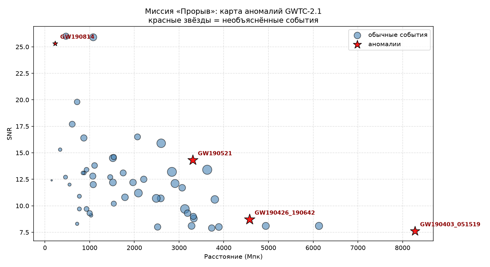

# 🚀 Миссия «Прорыв»

> **Поиск неизвестных аномалий в гравитационно-волновых данных LIGO/Virgo.**

## 🎯 Цель миссии: GW190814

Мы проанализировали **54 события** из открытого каталога GWTC-2.1 и нашли настоящую нерешённую аномалию. 

Событие **GW190814** — это слияние чёрной дыры массой 23,3 M☉ и загадочного объекта массой **2,6 M☉**. Этот объект попадает в «мёртвую зону»: он слишком тяжёл для нейтронной звезды (максимум ~2,2 M☉) и слишком лёгок для чёрной дыры (минимум ~3-5 M☉). Наука до сих пор не знает, что это было.

## 📊 Карта аномалий

На графике выше представлены все 54 события. **Красные звёзды** — это аномалии:
- **GW190814** (2,6 M☉) — объект X.
- **GW190521** (98 + 57 M☉) — чёрная дыра в «запрещённой зоне» масс.
- **GW190403_051519** (85 + 20 M☉) — рекордно далёкое событие (8280 Мпк).
- **GW190426_190642** (105 + 76 M☉) — гигантское слияние.

## 📁 Структура проекта

- `gwtc2_all.csv` — полный каталог 54 событий с массами, расстояниями и SNR.
- `anomaly_map.py` — скрипт на Python, который строит карту аномалий.
- `GW190814_DOSSIER.txt` — полное текстовое досье на аномалию GW190814.
- `anomaly_map.png` — визуализация карты.

## 🔭 Источник данных

Основано на открытых данных [Gravitational Wave Open Science Center](https://www.gw-openscience.org/).

---
*Проект создан в рамках исследовательской миссии «Прорыв».*
