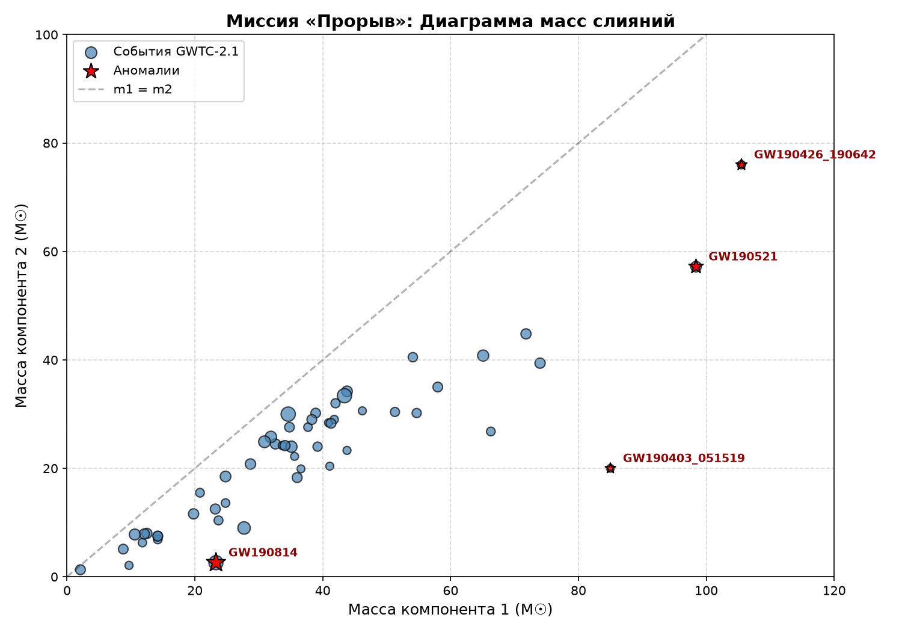
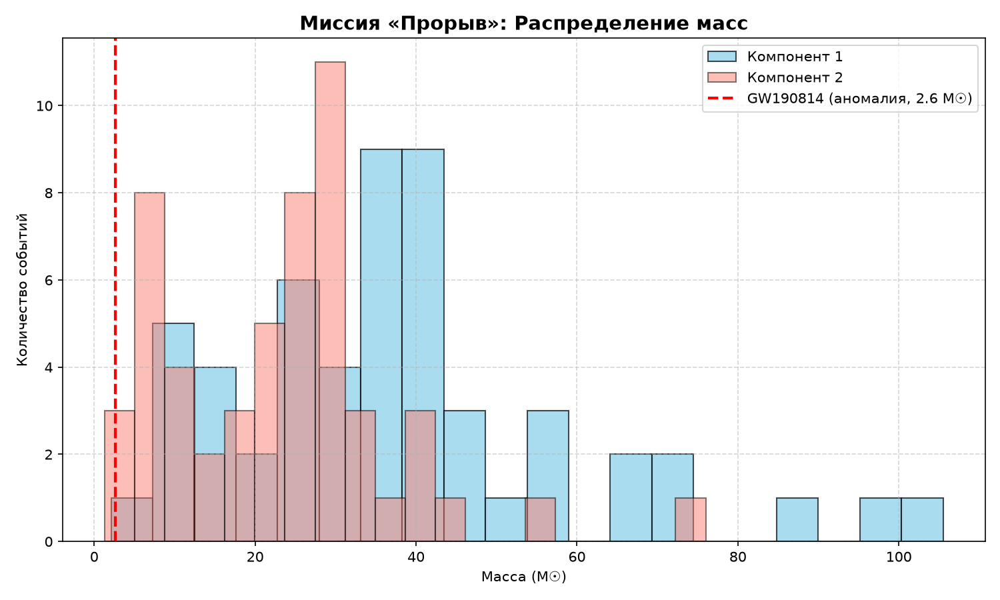
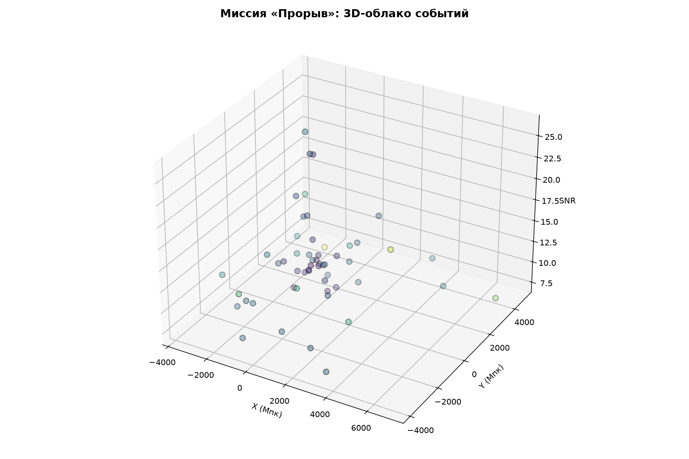

# 🚀 Миссия «Прорыв»

> **Глобальный анализ 54 гравитационно-волновых событий из каталога GWTC-2.1.**  
> **Цель:** обнаружение и классификация нерешённых аномалий в данных LIGO/Virgo.

---

## 🎯 Главная аномалия: GW190814

В ходе миссии мы проанализировали **54 события** слияния компактных объектов. Среди них обнаружен объект, который ставит в тупик современную астрофизику.

Событие **GW190814** представляет собой слияние чёрной дыры массой 23,3 M☉ и загадочного объекта массой **2,6 M☉**. Этот объект находится в так называемой «мёртвой зоне» (mass gap): 
- Он **слишком тяжёл** для нейтронной звезды (теоретический максимум ~2,2–2,3 M☉).
- Он **слишком лёгок** для чёрной дыры (минимум из известных ~3–5 M☉).
- Эффективный спин (chi_eff) равен 0,0, что нетипично для таких систем.
- Вероятность астрофизического происхождения (p_astro) = 1,0 (это не шум и не глитч).

**Возможные объяснения:** самая массивная нейтронная звезда в истории, самая лёгкая чёрная дыра, или экзотический объект (например, странная кварковая звезда). Вопрос остаётся открытым.

---

## 🗺️ Карта аномалий

На этой диаграмме рассеяния показаны все 54 события. По осям — расстояние (Мпк) и отношение сигнал/шум (SNR). Красные звёзды — это события, которые мы классифицировали как аномалии.

---

## ⚖️ Диаграмма масс

Здесь видно распределение масс компонентов. Обратите внимание на «пустоту» в районе 2,5–3 M☉ — именно там находится наш загадочный объект.

---

## 📊 Распределение масс

Гистограмма показывает, как часто встречаются объекты разной массы. Красная линия отмечает массу аномального объекта GW190814 (2,6 M☉). Видно, что он находится в «хвосте» распределения нейтронных звёзд, но ещё не дотягивает до чёрных дыр.

---

## 🌌 3D-облако событий

Трёхмерная визуализация каталога. Каждая точка — событие. Цвет указывает на массу первого компонента. Чем дальше точка от центра, тем дальше от нас произошло слияние.

---

## 📁 Структура проекта

- `data/gwtc2_all.csv` — полный каталог 54 событий (массы, расстояния, SNR, redshift, chi_eff).
- `scripts/anomaly_map.py` — код для построения карты аномалий.
- `scripts/gen_more_plots.py` — код для генерации диаграмм масс и 3D-карты.
- `docs/GW190814_DOSSIER.txt` — текстовое досье на аномалию.
- `*.png` — все визуализации.

---

## 🔭 Источник данных

Основано на открытых данных [Gravitational Wave Open Science Center](https://www.gw-openscience.org/) (каталог GWTC-2.1).

*Проект создан в рамках исследовательской миссии «Прорыв».*
