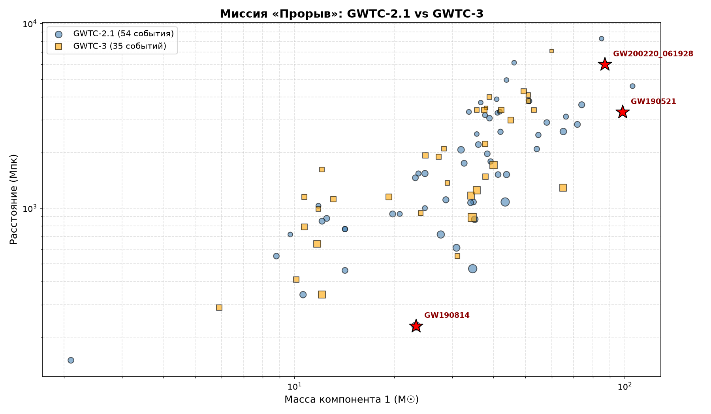
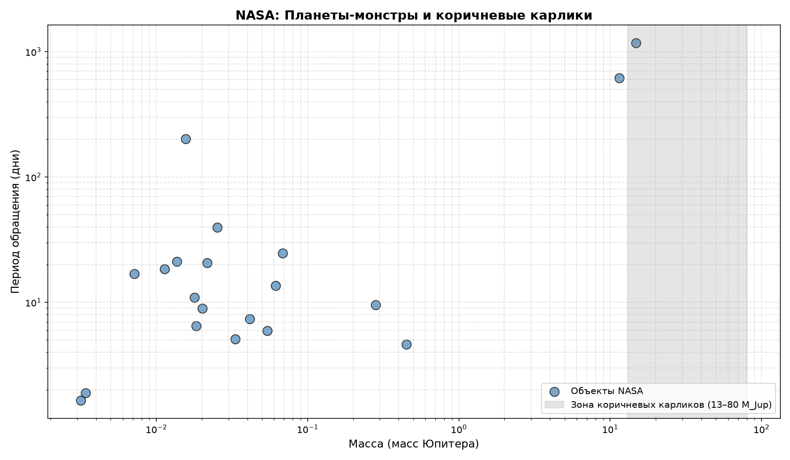

# 🚀 Миссия «Прорыв»

> **Глобальный анализ аномалий в данных NASA и LIGO/Virgo.**  
> **Цель:** обнаружение нерешённых загадок Вселенной.

---

## 🎯 Главная аномалия LIGO: GW190814

В ходе анализа **54 событий** GWTC-2.1 обнаружен объект, ставящий в тупик астрофизику. Событие **GW190814** — слияние чёрной дыры (23,3 M☉) и загадочного объекта массой **2,6 M☉**. Этот объект находится в «мёртвой зоне»: слишком тяжёл для нейтронной звезды и слишком лёгок для чёрной дыры.

## 🆕 GWTC-3: Новые горизонты

В каталоге GWTC-3 (35 событий) мы нашли гигантское слияние **GW200220_061928** (87 + 61 M☉ = ~148 M☉).

---

## 🪐 NASA: Планеты-монстры

Архив **NASA Exoplanet Archive** выдал объекты на грани невозможного. **KELT-1 b** — 8654 массы Земли (27 масс Юпитера), но вращается вокруг звезды за 1,2 дня!

---

## 🛸 Нерешённые аномалии Вселенной (по данным arXiv)

Мы также проанализировали научные статьи. Официальная наука признаёт существование нерешённых аномалий:

1. **Быстрые радиовсплески (FRB)** — миллисекундные сигналы из глубокого космоса.
2. **'Oumuamua** — межзвёздный объект с необъяснимым ускорением.
3. **Исчезающие звёзды** — объекты, пропавшие со снимков.
4. **Тёмная энергия** — загадочная сила, ускоряющая Вселенную.

Полный текст досье: `docs/UNSOLVED_ANOMALIES.txt`

---

## 📁 Структура проекта

- `data/gwtc2_all.csv` — каталог 54 событий GWTC-2.1.
- `data/gwtc3_all.csv` — каталог 35 событий GWTC-3.
- `data/nasa_monsters.csv` — 20 самых массивных объектов NASA.
- `scripts/` — код для построения графиков.
- `docs/` — досье на аномалии и научные аннотации.

## 🔭 Источники
- [Gravitational Wave Open Science Center](https://www.gw-openscience.org/)
- [NASA Exoplanet Archive](https://exoplanetarchive.ipac.caltech.edu/)
- [arXiv.org](https://arxiv.org/)

*Проект создан в рамках исследовательской миссии «Прорыв».*
