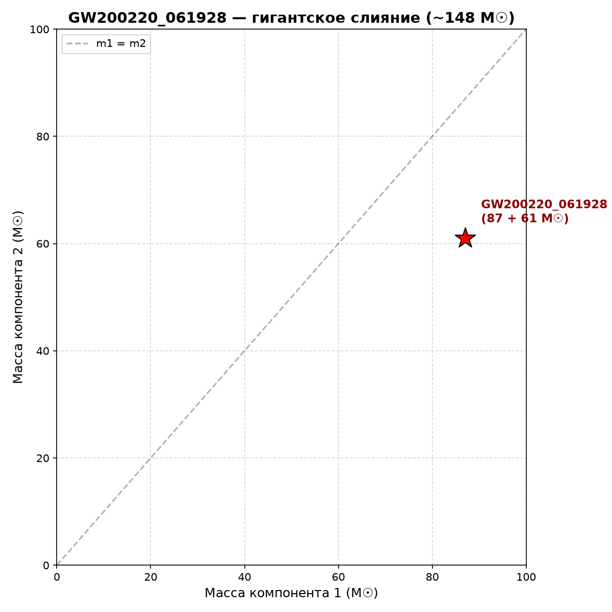

# 🚀 Миссия «Прорыв»

> **Глобальный анализ аномалий в данных NASA и LIGO/Virgo.**  
> **Цель:** обнаружение нерешённых загадок Вселенной.

---

## 🎯 Главная аномалия LIGO: GW190814

В ходе анализа **54 событий** GWTC-2.1 обнаружен объект, ставящий в тупик астрофизику. Событие **GW190814** — слияние чёрной дыры (23,3 M☉) и загадочного объекта массой **2,6 M☉**. Этот объект находится в «мёртвой зоне»: слишком тяжёл для нейтронной звезды и слишком лёгок для чёрной дыры. Вопрос остаётся открытым.

## ⚖️ Диаграмма масс (GWTC-2.1)

## 📊 Распределение масс

## 🌌 3D-облако событий

---

## 🪐 NASA: Планеты-монстры и коричневые карлики

Мы также прочесали архив **NASA Exoplanet Archive** и нашли объекты на грани невозможного. 

Самый яркий пример — **KELT-1 b**. Его масса составляет **8654 массы Земли** (27 масс Юпитера). По всем законам это уже коричневый карлик, а не планета, но он вращается вокруг звезды с периодом всего 1,2 дня! Как его не разорвало приливными силами — загадка.

Также в список попали **BD+20 2457 b** (21 масса Юпитера) и **eps Ind A b** (6,5 масс Юпитера, но период 70 лет!).

---

## 🆕 GWTC-3: Новые горизонты

В каталоге GWTC-3 (35 событий) мы нашли гигантское слияние **GW200220_061928** (87 + 61 M☉ = ~148 M☉). Это кандидат в «иерархическое слияние» — чёрную дыру, которая сама образовалась из предыдущих слияний.

---

## 📁 Структура проекта

- `data/gwtc2_all.csv` — каталог 54 событий GWTC-2.1.
- `data/gwtc3_all.csv` — каталог 35 событий GWTC-3.
- `data/nasa_monsters.csv` — 20 самых массивных объектов NASA.
- `scripts/` — код для построения всех графиков.
- `docs/GW190814_DOSSIER.txt` — досье на аномалию.

## 🔭 Источники
- [Gravitational Wave Open Science Center](https://www.gw-openscience.org/)
- [NASA Exoplanet Archive](https://exoplanetarchive.ipac.caltech.edu/)

*Проект создан в рамках исследовательской миссии «Прорыв».*
